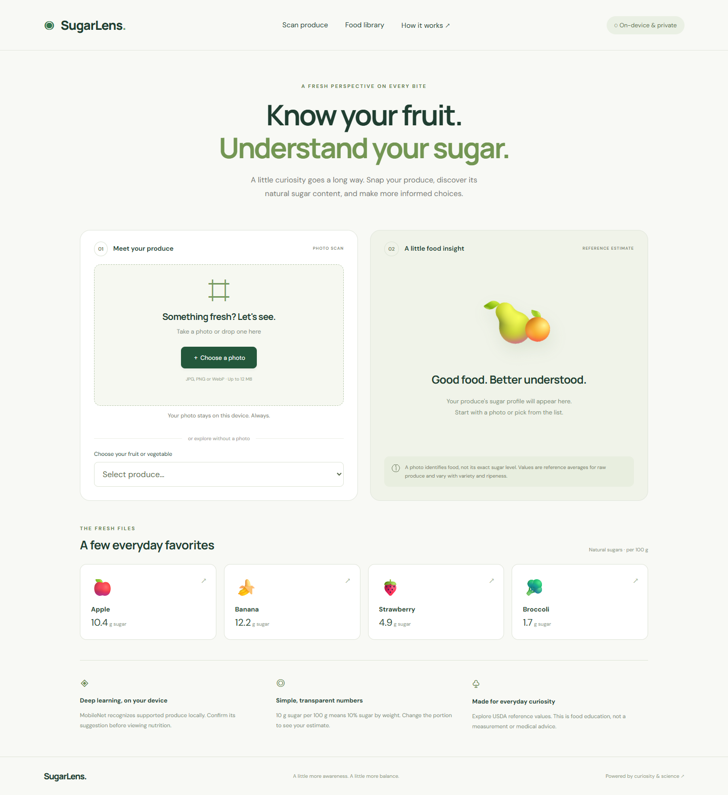
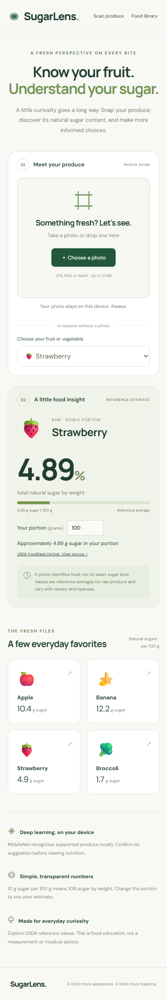

# DL – SugarLens

**A web and mobile progressive web app that recognizes fresh produce on your device and shows reference sugar content.**



SugarLens turns a photo of fruit or vegetables into a useful starting point for food awareness. A pretrained computer vision model suggests supported produce, the user confirms the identification, and the app looks up average total sugar per 100 g. Users can also browse the food library without uploading a photo and calculate sugar for a weighed portion.

## Is this ML, DL, or Gen AI?

**Project type: Deep Learning (DL), a subset of Machine Learning (ML).** MobileNet V2 is a pretrained convolutional neural network used for image classification through TensorFlow.js. This project performs inference; it does not train a custom model. It is not a generative AI project. Sugar percentages come from a nutrition lookup table, not a neural network prediction of sugar concentration.

**Display name:** DL – SugarLens · **Repository name:** `DL-SugarLens`

## Features

- Camera capture on supported phones, image upload, and desktop drag and drop.
- Local image recognition: photos are not sent to an inference server.
- Supported label suggestions with model confidence and explicit user confirmation.
- Manual lookup of 18 fruits and vegetables, including produce outside the classifier's supported labels.
- Total sugar in grams per 100 g, equivalent to sugar percentage by mass.
- Editable serving weight from 1–5,000 g with calculated estimated sugar.
- Direct links to USDA FoodData Central source records.
- Responsive desktop and mobile layouts, PWA manifest and service worker.
- Friendly handling of unsupported food, unreadable images, invalid portions, and model-loading failures.
- No account, database, API secret, or paid inference service required.

## Run locally

Requires Node.js 20.19+ or 22.12+ and npm.

```bash
npm ci
npm run dev
```

Open the URL printed by Vite, normally `http://127.0.0.1:5173`.

```bash
npm test
npm run build
npm run preview
```

The production build is in `dist/`. Serve that folder over HTTPS using a static hosting service. For subdirectory hosting, use `npm run build -- --base=./`. Never open `index.html` directly through `file://`.

## Mobile use

This is a **mobile web app / PWA**, not an App Store or Play Store native binary. Open the HTTPS deployment on Android or iPhone. Android Chrome offers **Install app / Add to Home screen** where supported; iOS Safari uses **Share → Add to Home Screen**. The camera chooser depends on the phone and browser. For local testing on a physical phone, use a trusted HTTPS tunnel or local HTTPS setup rather than the computer's loopback URL.

The service worker caches same-origin resources after successful requests. Previously visited manual lookup can work offline once all app resources have been cached. Model weights and external fonts are not guaranteed offline; first photo recognition requires internet. Installation behavior depends on the browser.



## Recognition coverage

Automatic suggestions map these MobileNet/ImageNet labels: Granny Smith → apple, banana, orange, strawberry, pineapple, lemon, broccoli, cucumber, cauliflower, bell pepper → red bell pepper, zucchini/courgette, and head cabbage. The apple suggestion uses a generic raw apple reference; the pepper suggestion uses raw red sweet pepper. **Confirm the actual variety and choose manually when the match is inappropriate.**

Carrot, tomato, watermelon, grapes, avocado, and mango are available for manual lookup. The classifier is a general ImageNet model, not a specialized food model. Mixed meals, multiple objects, cut produce, unusual lighting, and unsupported varieties can produce incorrect or no suggestions. It examines one image and does not detect or segment every food in a scene. Suggestions require at least 10% model probability and are never automatically treated as confirmed foods. That threshold is a usability filter, not a calibrated accuracy claim.

## How sugar estimates work

```text
Photo → local MobileNet V2 inference → supported label suggestions
      → user confirmation → USDA raw-food reference → serving calculation

Manual food selection ────────────────────────────────┘

Sugar percentage by mass = total sugar grams per 100 g
Portion sugar grams = reference sugar × edible portion grams ÷ 100
```

Example: raw banana has a reference value of **12.20 g total sugars per 100 g**, or **12.20% by weight**. A 200 g edible serving gives an estimate of **24.40 g**. The photo does not estimate serving mass; the user must enter a known weight.

The USDA API snapshot (retrieved 2026-10-28) is preserved in `docs/usda-reference-snapshot.json`. The reference table is in [`src/foods.js`](src/foods.js). Records represent raw edible portions, not juice, dried fruit, cooked foods, syrups, or added sugar. Actual sugar varies with cultivar, ripeness, storage, and preparation. Values are not Brix readings or laboratory measurements. This educational app is not intended for medical dosing or treatment decisions.

## Technology and structure

| Area | Implementation |
| --- | --- |
| Interface | Semantic HTML, CSS, vanilla JavaScript |
| Build | Vite |
| Inference | TensorFlow.js 4.22, MobileNet 2.1.1 package / V2 model |
| Data | Bundled USDA SR Legacy raw-produce total sugar values |
| Mobile | Responsive PWA, web manifest, service worker |
| Testing | Node test runner; Playwright browser verification |
| Backend | None |

```text
src/main.js             Photo flow, confirmation, portions, interface
src/foods.js            Nutrition records and supported model mappings
src/style.css           Responsive design and accessible focus states
public/                 PWA icons, manifest, service worker
tests/nutrition.test.js  Calculation, mapping and data integrity checks
scripts/verify.mjs      Desktop/mobile browser checks and real model smoke test
docs/                   Actual app screenshots
```

## Verification

`npm test` checks serving calculations, invalid input, exact label mapping, unsupported/low confidence rejection, and reference record integrity. `npm run build` creates the production bundle. Browser verification uses Microsoft Edge with Playwright:

```bash
# Start npm run dev in another terminal first
node scripts/verify.mjs
```

The browser script checks the desktop render, manual selection, serving edits, invalid portion input, food library navigation, invalid image handling, and 390 px mobile layout. It also downloads the real pretrained model and runs inference on a blank canvas to verify execution. This smoke test does not establish produce recognition accuracy. No held-out accuracy benchmark or real-device camera certification has been performed.

## Privacy and network behavior

Uploaded images remain in browser memory through local object URLs and are not persisted by the app. Model weights download from TensorFlow/Google hosting; typography may load from Google Fonts. Those services receive ordinary network request metadata. The app contains no analytics, photo upload endpoint, account registration, or scan history. Close the page to clear the in-memory photo.

## Sources and attribution

- [USDA FoodData Central](https://fdc.nal.usda.gov/) — individual source record links are included with every food result.
- [USDA SR Legacy data documentation](https://fdc.nal.usda.gov/data-documentation.html) — nutrient values and food reference context.
- [TensorFlow.js MobileNet documentation and source](https://github.com/tensorflow/tfjs-models/tree/master/mobilenet) — pretrained model, input handling, and class probabilities.
- [TensorFlow.js](https://www.tensorflow.org/js) — browser inference runtime.

Code is MIT licensed; dependencies and pretrained models retain their respective licenses. The screenshot images show this project's actual interface.

## Future improvements

Train and evaluate a dedicated produce classifier, support multiple foods through object detection, broaden nutrition coverage with reviewed source records, add explicit offline model management, and package native applications if app store distribution is required.

