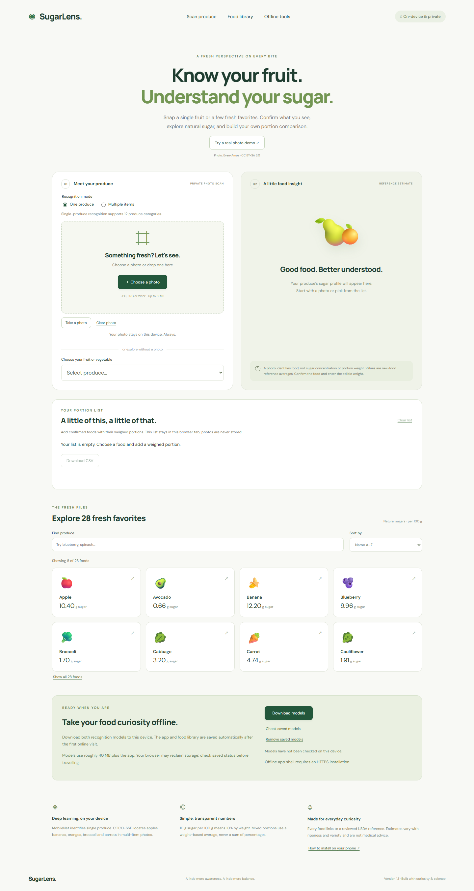
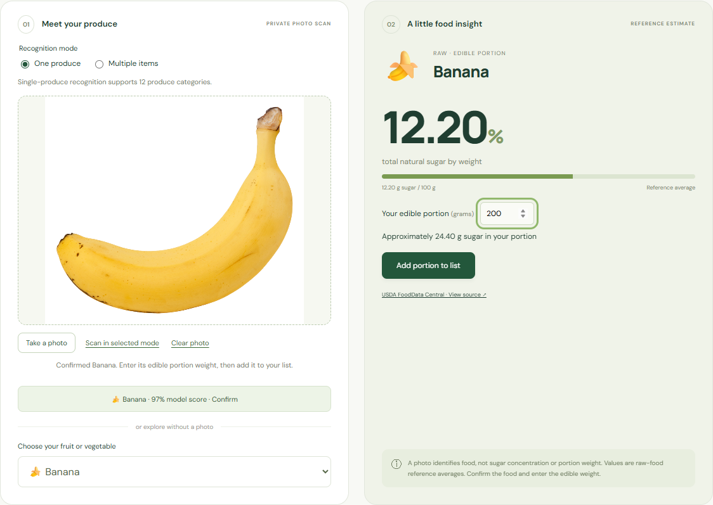
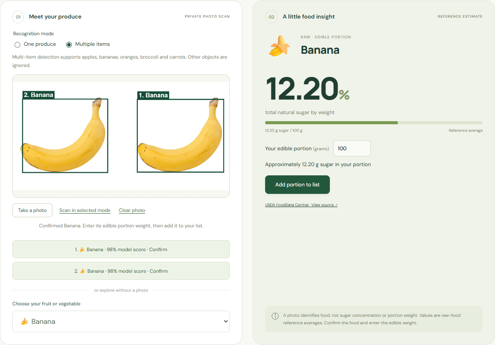
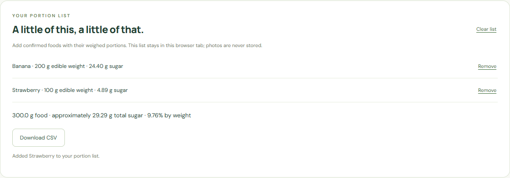
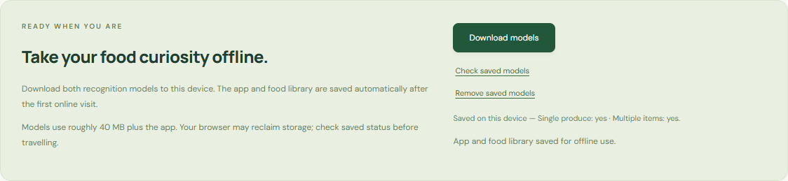
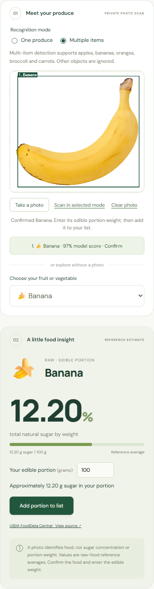

# DL – SugarLens

**Private, on-device produce recognition with transparent sugar estimates. Web, mobile PWA, and Capacitor native packaging.**

[Open the live demo](https://sugarlens-produce-vams2krish.adam-vamshikrishna.chatgpt.site) · [Source code](https://github.com/vams2krish/DL-SugarLens) · [Model and data limitations](#scope-and-limitations)

The live deployment retains owner-only access; the GitHub source is public. Sign in with the owner's account to open the hosted app.



SugarLens identifies supported fruits and vegetables from a photo, asks you to confirm the match, and looks up average natural sugar content from USDA FoodData Central. It never claims to measure sugar or portion weight from pixels. The first roadmap release adds multiple object detection, 28 source-verified foods, weighted portion comparisons, CSV export, explicit offline model storage, and native packaging commands.

## Product showcases

### 1. Real photo → confirmation → sugar estimate

The **Try a real photo demo** button runs the actual MobileNet model on the included banana photograph. After confirmation, entering 200 g produces an estimate of **24.40 g sugar**. No recognition responses are mocked or prerecorded.



### 2. More than one item in a photo

COCO-SSD locates supported objects independently and draws numbered bounding boxes. Each match has its own confirmation button. This showcase uses two copies of the licensed demo photograph, with two real detections.



### 3. Compare real portions and export your list

Add a weighed portion of each confirmed food. A 200 g banana portion plus 100 g strawberry contains approximately **29.29 g total sugar** in 300 g food, or **9.76% by mass**. The total is a mass-weighted calculation, not a sum of food percentages. Download the actual rows as a CSV.



### 4. Save recognition for offline use

Download both model weights to browser IndexedDB, check their saved status, or remove them. The production service worker precaches app code, bundled fonts, the food library and demo photo. Recognition loads the saved weights after a reload without contacting an inference server.



### 5. The mobile experience

The same features adapt to a narrow phone viewport. Camera capture and photo selection are separate controls. Add the PWA to your home screen through the browser menu.



## Is this ML, DL or Gen AI?

**Deep Learning (DL), a subset of Machine Learning (ML).** MobileNet V2 performs single-image classification; COCO-SSD with a Lite MobileNet V2 backbone performs object detection. These are pretrained neural networks running through TensorFlow.js in the browser. This project uses inference, not a newly trained produce-specific model. It is not generative AI. Sugar estimates come from reviewed nutrition records and arithmetic.

## What shipped in version 1.1

| Roadmap area | Delivered behavior |
| --- | --- |
| Multiple foods | Numbered bounding boxes and independent confirmation for supported COCO-SSD produce classes |
| Nutrition coverage | 28 raw produce records, each matched against saved USDA API snapshots |
| Exploration | Search by food name, sort by sugar/name, show all/fewer foods |
| Portion comparisons | Add/remove up to 100 portions, mass-weighted total, tab-session recovery and CSV export |
| Offline recognition | Explicit model download, check and removal using versioned IndexedDB entries |
| Offline app | Versioned service worker precache, local fonts, update prompt and offline connection indicator |
| Product demo | Bundled, licensed real photograph; real inference; reproducible two-object E2E fixture |
| Native delivery | Capacitor config plus reproducible Android/iOS preparation commands; Android generation/sync verified |
| Verification | Unit tests, production-browser E2E checks, mobile layout and real-model inference checks |

## Run locally

Use **Node.js 22.12+** and npm (Capacitor CLI requires Node 22+).

```bash
npm ci
npm run dev
```

For a production demo on your computer:

```bash
npm run build
npm run preview -- --port 4173
```

Open `http://127.0.0.1:4173`. The first online visit precaches the shell. Click **Download models** before trying offline recognition. On a phone, open the HTTPS deployment; your computer's loopback URL does not point to the computer from another device.

## Repeatable end-to-end demo

1. Click **Try a real photo demo**. Wait for real inference, then confirm **Banana**.
2. Enter **200** in edible portion grams. Verify **24.40 g sugar**, then **Add portion to list**.
3. Choose **Strawberry**, leave 100 g, and add it. Verify the total **29.29 g sugar / 9.76%**.
4. Click **Download CSV** and inspect the two source-linked rows.
5. Select **Multiple items**, then **Scan in selected mode**. The detector draws a banana box. Upload your own photo containing supported objects to explore multiple matches.
6. Search **blue** in the library and select **Blueberry** for its USDA sugar profile.
7. Click **Download models**, wait until both say **yes**, reload, and check their status.
8. Disable network access and reload. Repeat the photo demo in both modes; manual food lookup and portions also remain available.
9. Remove saved models. Without network access, recognition explains the missing download while manual lookup continues working.

Actual photographed food can be misidentified. Confirm every match and correct it manually before relying on reference values.

## Recognition and nutrition coverage

**Single-produce mode:** ImageNet labels for Granny Smith/apple, banana, orange, strawberry, pineapple, lemon, broccoli, cucumber, cauliflower, bell pepper, zucchini/courgette and head cabbage. Suggestions require at least 10% model probability. The general apple reference is not variety-specific; bell pepper uses the red sweet pepper reference.

**Multi-item mode:** apple, banana, orange, broccoli and carrot only, with a 50% score threshold and up to 20 objects per image. Other COCO classes are ignored. Detection boxes do not measure edible mass, reliably count obscured fruit, or segment the food. Thresholds are usability filters, not calibrated accuracy guarantees.

**Manual library:** Apple, Banana, Orange, Strawberry, Pineapple, Lemon, Broccoli, Cucumber, Carrot, Tomato, Watermelon, Grapes, Avocado, Cauliflower, Red bell pepper, Zucchini, Cabbage, Mango, Blueberry, Raspberry, Pear, Peach, Plum, Kiwi, Spinach, Celery, Onion and Potato.

Every record links to its USDA FDC ID. Reviewed snapshots are in [`docs/usda-reference-snapshot.json`](docs/usda-reference-snapshot.json) and [`docs/usda-roadmap-snapshot.json`](docs/usda-roadmap-snapshot.json), retrieved October 28, 2026. Tests assert that all bundled sugar values match these snapshots.

```text
Photo → local MobileNet classification / COCO-SSD detection
      → user confirmation → USDA reference → user-entered edible grams
      → estimated sugar → optional portion list and CSV

Food sugar % by mass = grams total sugar per 100 g food
Portion sugar = food sugar per 100 g × edible portion grams ÷ 100
Combined sugar % = sum(portion sugar) ÷ sum(portion grams) × 100
```

## Offline use, privacy and updates

The production build precaches its versioned app shell, JavaScript modules, local fonts, demo image and source-backed food table. Model weights are saved only after **Download models**. This uses roughly 40 MB for models plus app resources, depending on backend/version. Browser storage limits, private browsing and automatic eviction can prevent persistence. **Check saved models** before travelling; download success does not guarantee indefinite storage retention.

Uploaded photos are decoded into an in-memory canvas, resized to a maximum 1,280 px edge for inference, and never uploaded or persisted. Inputs are limited to JPG/PNG/WebP, 12 MB, and 40 megapixels. Convert unsupported formats such as HEIC first. New or invalid uploads clear previous photo results. The portion list stores only food IDs and entered weights in `sessionStorage`; clear it explicitly or close the tab. No account database, photo history or analytics is included.

Initial model downloads use TensorFlow/Google model hosting, which receives ordinary network metadata. Font files are bundled locally. Online navigation refreshes through the host so its authentication redirects remain valid; offline navigation reconstructs the saved shell response without redirect or compression metadata. A dedicated service-worker regression test covers this hosted reload path. New app versions show an update action; activating it preserves the current tab's portion list. Model removal clears the saved recognition weights without deleting food data or the app shell.

## Mobile and native packaging

The deployed version is an **installable PWA**, not a signed app-store binary. iPhone Safari: **Share → Add to Home Screen**. Android Chrome: **Install app / Add to Home screen**. The in-app install button opens the browser install prompt where available, otherwise it displays instructions.

Capacitor packaging shares the production `dist/` implementation:

```bash
npm run native:android
npx cap open android

# Run on a Mac with Xcode for iOS development
npm run native:ios
npx cap open ios
```

The preparation commands create the platform folder if needed and sync the current web build. Generated platform folders are ignored so they can be recreated. Android source generation and sync were verified on Windows. Building/signing Android requires Android Studio and the Android SDK; iOS builds/signing require macOS and Xcode. Camera chooser behavior and offline storage must be validated on physical target devices before store submission. No APK, AAB, IPA or store release is claimed in this version.

## Verification and delivery

```bash
npm test
npm run build
npm run preview -- --port 4173   # Keep running in a separate terminal
npm run test:e2e
```

E2E uses local Microsoft Edge through Playwright. In CI it uses Playwright Chromium (`npx playwright install --with-deps chromium`). It tests the actual production build and real models, not mocked predictions. It covers photo confirmation, two-object detection, portion arithmetic and CSV bytes, nutrition search, offline model persistence/reload, invalid image recovery, mobile overflow, removal and missing-model fallback. It also captures the README showcases and writes an inspectable result to [`docs/verification.json`](docs/verification.json).

The automated demo is a small curated regression test, not a statistically meaningful accuracy benchmark. It cannot replace diverse camera testing, accessibility review or physical-device validation. Dependency audits check known advisories at the time they run; they are not a security certification.

```text
src/main.js          Product interface, camera/upload flow, food library and portions
src/inference.js     Lazy model loading, IndexedDB persistence and removal
src/foods.js         USDA references and supported recognition mappings
src/portions.js      Weighted calculations and CSV serialization
src/style.css        Responsive visual design and keyboard focus states
scripts/prepare-sw.mjs Build-specific precache generation
scripts/native.mjs   Reproducible native source preparation
scripts/verify.mjs   Production E2E flow and actual product screenshots
public/demo/         Licensed photograph and attribution
docs/                Product showcases, source snapshots and verification evidence
```

## Scope and limitations

Reference values describe raw edible produce, not juice, dried fruit, mixed recipes, cooked food or added sugars. Ripeness, cultivar, storage and preparation affect actual sugar. The app does not measure Brix or laboratory sugar concentration and is not intended for medical dosing or treatment decisions. Weights must be supplied by the user.

The general-purpose pretrained models have narrow supported produce labels and can misidentify unusual lighting, sliced food, crowded scenes and unsupported varieties. No custom model has been trained and no held-out produce benchmark is claimed. CPU-only inference may be slower on older phones.

## Next roadmap

| Next step | What is needed |
| --- | --- |
| Dedicated produce classifier | Licensed diverse dataset, train/validation/test separation, held-out class-level metrics and model export |
| Broader multi-food recognition | Produce-specific detection data, bounding-box labels and evaluation beyond the five supported COCO food classes |
| Physical mobile certification | Android/iOS camera, memory, offline persistence, install/update and accessibility checks on target devices |
| Signed native releases | Platform SDKs, signing identities, final app identifiers, icons and store submissions |
| Nutrition expansion | Further reviewed raw/cooked/variety-specific records with explicit preparation selection |

## Sources and licenses

- [USDA FoodData Central](https://fdc.nal.usda.gov/) and [data documentation](https://fdc.nal.usda.gov/data-documentation.html).
- [MobileNet model documentation](https://github.com/tensorflow/tfjs-models/tree/master/mobilenet) and [COCO-SSD documentation](https://github.com/tensorflow/tfjs-models/tree/master/coco-ssd).
- [TensorFlow.js model storage documentation](https://www.tensorflow.org/js/guide/save_load).
- [Capacitor documentation](https://capacitorjs.com/docs).
- Demo photo: [Banana-Single.jpg](https://commons.wikimedia.org/wiki/File:Banana-Single.jpg), **Evan-Amos**, [CC BY-SA 3.0](https://creativecommons.org/licenses/by-sa/3.0/). The original photo is bundled unchanged. The two-photo demo montage and screenshot regions incorporating the photo retain CC BY-SA 3.0. No endorsement is implied.
- Application code: MIT. Dependencies, model weights and fonts retain their respective licenses. Product showcases are screenshots of the actual application.
